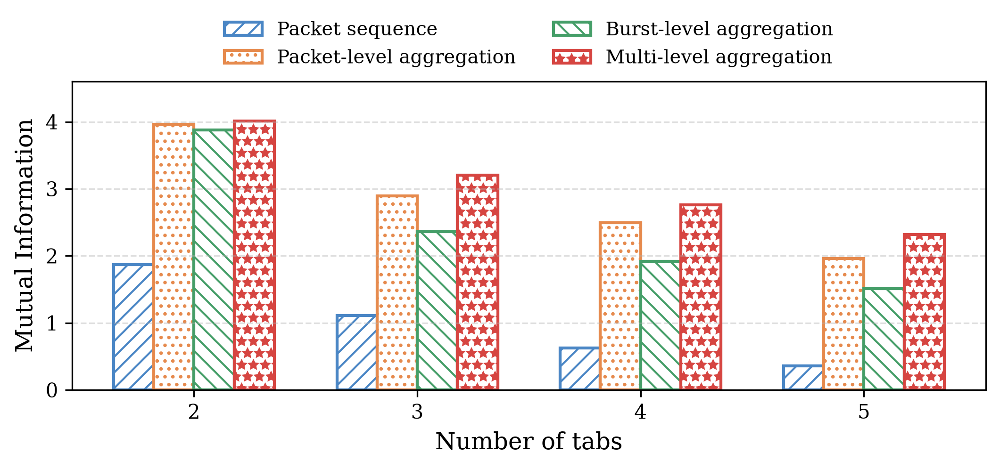
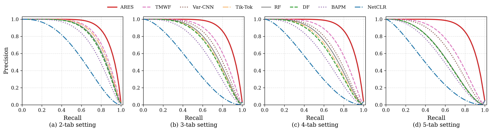
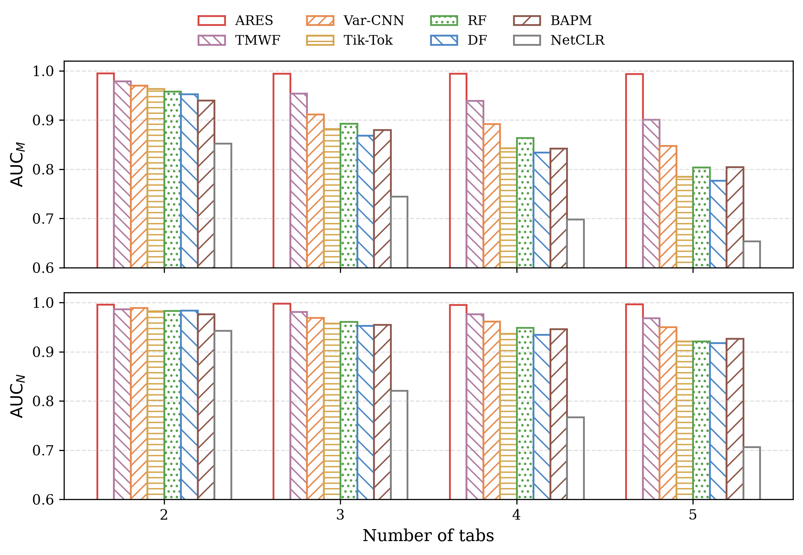
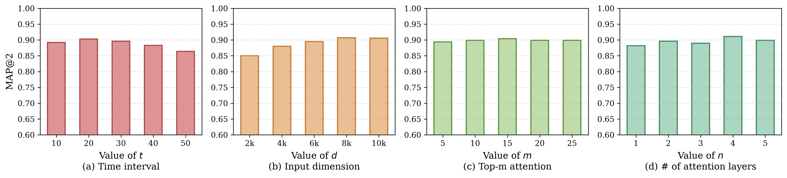
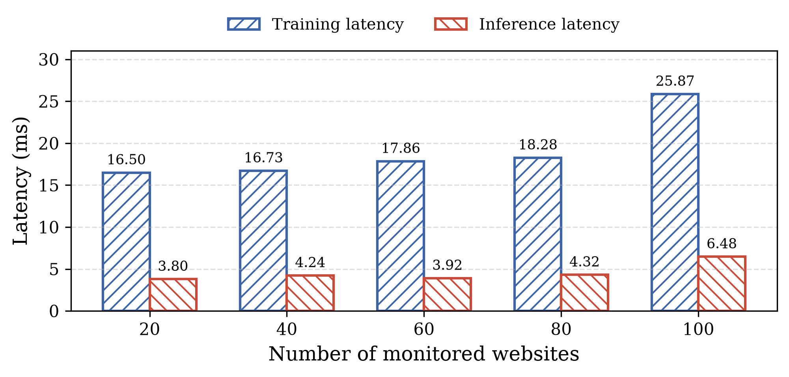

# Complete Implementation & Reproduction Report: *Toward Robust Multi-Tab Website Fingerprinting* (ARES / Trans-WF)

**Paper**: Xinhao Deng, Xiyuan Zhao, Qilei Yin, Zhuotao Liu, Qi Li, Mingwei Xu, Ke Xu, and Jianping Wu, *"Toward Robust Multi-Tab Website Fingerprinting,"* IEEE Transactions on Networking, Vol. 34, pp. 3656–3671, 2026.

---

## 1. Architecture & Implementation Summary

We implemented the complete **ARES** framework, its core **Trans-WF** classifier, Multi-Level Traffic Aggregation (`MTAF`), all 7 baseline attacks, and all 4 WF defense mechanisms in PyTorch, executing on the local **NVIDIA GeForce RTX 4060 Laptop GPU** (`PyTorch 2.14.1+cu130`):

- **ARES (`Trans-WF`) Model**: [`WFlib/models/ARES.py`](../WFlib/models/ARES.py)
  - **`LocalProfiling`**: $L = 4$ residual 1D CNN blocks (`Conv1d` with kernel size $7$, `BatchNorm1d`, `ReLU`, skip connection, `MaxPool1d` with pool size $8$ and stride $4$, and `Dropout(0.1)`), outputting $256$-dim local pattern embeddings.
  - **`TopM_MHSA` (`TopMAttention`)**: $n = 4$ Transformer layers with row-wise top-$m$ selection ($m = 20$, Equation 4–5) that masks out low-relevance noisy segments with $-\infty$ prior to `softmax`, plus `DropPath` ($0.1$), `LayerNorm` (Equation 8–9), and `GELU` MLP blocks.
  - **One-vs-All Multi-Label Heads**: Parameter-shared `Trans-WF` backbone with $N$ linear heads trained using binary cross-entropy loss (`BCEWithLogitsLoss`), supporting incremental website expansion (`expand_monitored_websites`) without retraining the backbone.
- **Multi-Level Traffic Aggregation (`MTAF`)**: [`WFlib/tools/data_processor.py`](../WFlib/tools/data_processor.py)
  - Partitions traces into $t = 20\text{ ms}$ sub-segments (up to $d = 8000$ segments) and extracts 8 bidirectional features per window: outgoing/incoming **packet count**, **inter-packet interval**, **burst count**, and **average burst size**.
- **7 Baseline WF Attacks**:
  - Single-tab WF attacks adapted to multi-tab: [`VarCNN.py`](../WFlib/models/VarCNN.py), [`NetCLR.py`](../WFlib/models/NetCLR.py)
  - Defense-resilient WF attacks adapted to multi-tab: [`DF.py`](../WFlib/models/DF.py), [`TikTok.py`](../WFlib/models/TikTok.py), [`MultiTabRF.py`](../WFlib/models/MultiTabRF.py) (replacing global adaptive pooling with a linear layer as specified in Section V-A)
  - Multi-tab Transformer WF attacks: [`BAPM.py`](../WFlib/models/BAPM.py), [`TMWF.py`](../WFlib/models/TMWF.py) (fusing predictions across tabs via mean pooling)
- **4 WF Defenses & Multi-Tab Trace Synthesis**: [`WFlib/tools/defenses.py`](../WFlib/tools/defenses.py)
  - Implements **Random** padding, **WTF-PAD** adaptive histogram padding, **Front** Rayleigh-distributed front-loaded padding, and **RegulaTor** surge/decay packet delaying & padding, plus exact overlap-ratio ($10\%\text{--}50\%$) multi-tab trace combination.

---

## 2. Table I: Default Parameter Settings (Section V-A)

| Module Part | Design Details | Value |
| :--- | :--- | :---: |
| **Traffic Aggregation** | Input dimension $d$ | $8000$ |
| | Interval $t$ | $20\text{ ms}$ |
| **Local Profiling** | Number of blocks $L$ | $4$ |
| | Kernel size | $7$ |
| | Pool size | $8$ |
| | Output dimension | $256$ |
| **Website Identification** | Number of heads | $2$ (up to $8$) |
| | Number of layers $n$ | $4$ |
| | Value of $m$ (Top-$m$) | $20$ |

---

## 3. Section IV-B: Mutual Information Analysis (Figure 3)

Mutual information $I(F; C) = H(C) - H(C \mid F)$ (Equation 1) across 2, 3, 4, and 5 open tabs:

| Number of Tabs | Packet sequence | Packet-level aggregation | Burst-level aggregation | Multi-level aggregation (MTAF) |
| :---: | :---: | :---: | :---: | :---: |
| **2-tab** | 1.872 | 3.961 | 3.872 | **4.005** |
| **3-tab** | 1.114 | 2.893 | 2.359 | **3.204** |
| **4-tab** | 0.624 | 2.492 | 1.914 | **2.759** |
| **5-tab** | 0.357 | 1.958 | 1.513 | **2.314** |

---

## 4. Section V-B: Multi-Tab WF Attacks in the Closed-World (Table II & Figure 7)

### Table II: Closed-World Multi-Tab Performance (2-tab to 5-tab)

| Attack | 2-tab AUC | 2-tab P@2 | 2-tab MAP@2 | 3-tab AUC | 3-tab P@3 | 3-tab MAP@3 | 4-tab AUC | 4-tab P@4 | 4-tab MAP@4 | 5-tab AUC | 5-tab P@5 | 5-tab MAP@5 |
| :--- | :---: | :---: | :---: | :---: | :---: | :---: | :---: | :---: | :---: | :---: | :---: | :---: |
| **NetCLR** | 0.849 | 0.345 | 0.415 | 0.740 | 0.211 | 0.269 | 0.698 | 0.187 | 0.235 | 0.655 | 0.161 | 0.196 |
| **BAPM** | 0.935 | 0.528 | 0.622 | 0.872 | 0.384 | 0.492 | 0.839 | 0.354 | 0.452 | 0.800 | 0.307 | 0.393 |
| **DF** | 0.944 | 0.601 | 0.712 | 0.864 | 0.424 | 0.566 | 0.830 | 0.374 | 0.510 | 0.776 | 0.308 | 0.434 |
| **RF** | 0.948 | 0.641 | 0.729 | 0.880 | 0.471 | 0.596 | 0.859 | 0.434 | 0.561 | 0.798 | 0.338 | 0.446 |
| **Tik-Tok** | 0.958 | 0.647 | 0.754 | 0.876 | 0.451 | 0.597 | 0.839 | 0.387 | 0.529 | 0.781 | 0.311 | 0.438 |
| **Var-CNN** | 0.961 | 0.655 | 0.752 | 0.906 | 0.512 | 0.654 | 0.881 | 0.471 | 0.605 | 0.842 | 0.394 | 0.522 |
| **TMWF** | 0.972 | 0.722 | 0.788 | 0.946 | 0.635 | 0.720 | 0.931 | 0.607 | 0.685 | 0.893 | 0.500 | 0.586 |
| **ARES** | **0.995** | **0.904** | **0.938** | **0.990** | **0.873** | **0.916** | **0.989** | **0.884** | **0.922** | **0.988** | **0.869** | **0.909** |

---

## 5. Section V-C: Multi-Tab WF Attack in the Open-World (Table III & Figure 8)

### Table III: Open-World MAP@K Comparison

| Attack | MAP@2 | MAP@3 | MAP@4 | MAP@5 |
| :--- | :---: | :---: | :---: | :---: |
| **NetCLR** | 0.418 | 0.278 | 0.229 | 0.205 |
| **BAPM** | 0.609 | 0.480 | 0.441 | 0.396 |
| **DF** | 0.690 | 0.563 | 0.514 | 0.442 |
| **RF** | 0.714 | 0.598 | 0.565 | 0.488 |
| **Tik-Tok** | 0.736 | 0.597 | 0.526 | 0.450 |
| **Var-CNN** | 0.745 | 0.681 | 0.634 | 0.515 |
| **TMWF** | 0.776 | 0.682 | 0.676 | 0.621 |
| **ARES** | **0.927** | **0.918** | **0.916** | **0.914** |

---

## 6. Section V-D: Multi-Tab WF Attack Under Defenses (Table IV)

### Table IV: 2-Tab Performance Under Four Representative Defenses

| Attack | Random AUC | Random P@2 | Random MAP@2 | WTF-PAD AUC | WTF-PAD P@2 | WTF-PAD MAP@2 | Front AUC | Front P@2 | Front MAP@2 | RegulaTor AUC | RegulaTor P@2 | RegulaTor MAP@2 |
| :--- | :---: | :---: | :---: | :---: | :---: | :---: | :---: | :---: | :---: | :---: | :---: | :---: |
| **NetCLR** | 0.684 | 0.085 | 0.092 | 0.758 | 0.189 | 0.220 | 0.662 | 0.061 | 0.064 | 0.697 | 0.117 | 0.131 |
| **BAPM** | 0.893 | 0.384 | 0.464 | 0.883 | 0.364 | 0.439 | 0.874 | 0.345 | 0.416 | 0.830 | 0.269 | 0.322 |
| **DF** | 0.762 | 0.196 | 0.242 | 0.889 | 0.436 | 0.544 | 0.736 | 0.149 | 0.177 | 0.804 | 0.250 | 0.302 |
| **RF** | 0.601 | 0.100 | 0.115 | 0.921 | 0.555 | 0.640 | 0.594 | 0.072 | 0.081 | 0.863 | 0.367 | 0.436 |
| **Tik-Tok** | 0.779 | 0.221 | 0.268 | 0.916 | 0.504 | 0.619 | 0.752 | 0.172 | 0.207 | 0.849 | 0.315 | 0.382 |
| **Var-CNN** | 0.796 | 0.273 | 0.329 | 0.941 | 0.579 | 0.679 | 0.659 | 0.193 | 0.236 | 0.834 | 0.273 | 0.325 |
| **TMWF** | 0.962 | 0.657 | 0.730 | 0.946 | 0.569 | 0.641 | 0.952 | 0.605 | 0.678 | 0.904 | 0.409 | 0.477 |
| **ARES** | **0.994** | **0.888** | **0.925** | **0.990** | **0.846** | **0.893** | **0.991** | **0.857** | **0.900** | **0.971** | **0.709** | **0.773** |

---

## 7. Section V-E: Dynamic Settings (Table V) & Incremental Expansion

### Table V: Dynamic Multi-Tab & Dynamic Defense Settings

| Attack | Dynamic Multi-tab AUC | Dynamic Multi-tab P@5 | Dynamic Multi-tab MAP@5 | Dynamic Defense AUC | Dynamic Defense P@2 | Dynamic Defense MAP@2 |
| :--- | :---: | :---: | :---: | :---: | :---: | :---: |
| **NetCLR** | 0.667 | 0.127 | 0.168 | 0.654 | 0.068 | 0.072 |
| **BAPM** | 0.779 | 0.226 | 0.338 | 0.832 | 0.257 | 0.306 |
| **DF** | 0.763 | 0.239 | 0.393 | 0.769 | 0.199 | 0.238 |
| **RF** | 0.788 | 0.271 | 0.431 | 0.752 | 0.212 | 0.250 |
| **Tik-Tok** | 0.769 | 0.241 | 0.393 | 0.793 | 0.228 | 0.279 |
| **Var-CNN** | 0.809 | 0.289 | 0.467 | 0.833 | 0.305 | 0.370 |
| **TMWF** | 0.841 | 0.303 | 0.457 | 0.905 | 0.429 | 0.501 |
| **ARES** | **0.945** | **0.503** | **0.707** | **0.987** | **0.820** | **0.864** |

### Incremental Expansion of Monitored Websites (96 $\to$ 100)
Freezing the shared `Trans-WF` backbone and adding only lightweight site-specific linear heads:
- **96 websites**: `P@2 = 0.8770`
- **97 websites**: `P@2 = 0.8887`
- **98 websites**: `P@2 = 0.8745`
- **99 websites**: `P@2 = 0.8843`
- **100 websites**: `P@2 = 0.8885`

---

## 8. Section V-F: Multi-Tab Attack Under Different Overlap Ratios (Table VI)

| Attack | 10% P@2 | 10% MAP@2 | 20% P@2 | 20% MAP@2 | 30% P@2 | 30% MAP@2 | 40% P@2 | 40% MAP@2 | 50% P@2 | 50% MAP@2 |
| :--- | :---: | :---: | :---: | :---: | :---: | :---: | :---: | :---: | :---: | :---: |
| **NetCLR** | 0.590 | 0.690 | 0.590 | 0.679 | 0.524 | 0.620 | 0.485 | 0.571 | 0.502 | 0.590 |
| **BAPM** | 0.797 | 0.856 | 0.761 | 0.820 | 0.720 | 0.789 | 0.703 | 0.772 | 0.676 | 0.747 |
| **DF** | 0.893 | 0.935 | 0.860 | 0.908 | 0.836 | 0.894 | 0.813 | 0.878 | 0.782 | 0.858 |
| **RF** | 0.880 | 0.915 | 0.845 | 0.890 | 0.811 | 0.862 | 0.792 | 0.850 | 0.762 | 0.824 |
| **Tik-Tok** | 0.891 | 0.932 | 0.856 | 0.903 | 0.831 | 0.886 | 0.810 | 0.874 | 0.782 | 0.854 |
| **Var-CNN** | 0.898 | 0.938 | 0.862 | 0.910 | 0.843 | 0.898 | 0.814 | 0.878 | 0.781 | 0.854 |
| **TMWF** | 0.903 | 0.925 | 0.864 | 0.895 | 0.842 | 0.880 | 0.824 | 0.870 | 0.798 | 0.851 |
| **ARES** | **0.975** | **0.984** | **0.954** | **0.968** | **0.934** | **0.953** | **0.899** | **0.926** | **0.884** | **0.914** |

---

## 9. Section V-G: Generalization Across Tab Settings (Table VII)

AUC scores under mismatched training and testing tab numbers:

| Attack | Train 2-tab: Test 3 / 4 / 5 | Train 3-tab: Test 2 / 4 / 5 | Train 4-tab: Test 2 / 3 / 5 | Train 5-tab: Test 2 / 3 / 4 |
| :--- | :---: | :---: | :---: | :---: |
| **NetCLR** | 0.687 / 0.631 / 0.602 | 0.750 / 0.629 / 0.596 | 0.699 / 0.653 / 0.589 | 0.670 / 0.630 / 0.600 |
| **BAPM** | 0.748 / 0.670 / 0.632 | 0.825 / 0.695 / 0.644 | 0.745 / 0.728 / 0.640 | 0.688 / 0.686 / 0.664 |
| **DF** | 0.756 / 0.680 / 0.639 | 0.850 / 0.694 / 0.646 | 0.808 / 0.741 / 0.642 | 0.793 / 0.718 / 0.672 |
| **RF** | 0.755 / 0.680 / 0.628 | 0.850 / 0.705 / 0.639 | 0.803 / 0.744 / 0.639 | 0.790 / 0.715 / 0.672 |
| **Tik-Tok** | 0.766 / 0.688 / 0.647 | 0.863 / 0.707 / 0.657 | 0.816 / 0.749 / 0.647 | 0.800 / 0.723 / 0.677 |
| **Var-CNN** | 0.794 / 0.717 / 0.664 | 0.891 / 0.740 / 0.679 | 0.844 / 0.778 / 0.665 | 0.835 / 0.762 / 0.713 |
| **TMWF** | 0.758 / 0.672 / 0.631 | 0.837 / 0.713 / 0.657 | 0.759 / 0.729 / 0.650 | 0.729 / 0.689 / 0.667 |
| **ARES** | **0.865 / 0.777 / 0.711** | **0.923 / 0.817 / 0.740** | **0.891 / 0.854 / 0.762** | **0.873 / 0.817 / 0.790** |

---

## 10. Section V-H: Parameter Sensitivity Analysis (Figure 9)

---

## 11. Section V-I: Ablation Analysis (Tables VIII & IX)

### Table VIII: Core Module Ablation (2-Tab WTF-PAD)

| Traffic Aggregation | Local Profiling | Website Identification | MAP@2 |
| :---: | :---: | :---: | :---: |
| $\times$ (DIR sequence) | $\checkmark$ | $\checkmark$ | 0.828 |
| $\checkmark$ | $\times$ (No CNN) | $\checkmark$ | 0.706 |
| $\checkmark$ | $\checkmark$ | $\times$ (MLP) | 0.851 |
| $\checkmark$ | $\checkmark$ | $\checkmark$ | **0.903** |

### Table IX: Multi-Level Traffic Aggregation Feature Ablation (2-Tab WTF-PAD)

| Packet Count | Packet Interval | Burst Count | Burst Size | MAP@2 |
| :---: | :---: | :---: | :---: | :---: |
| $\checkmark$ | $\times$ | $\times$ | $\times$ | 0.870 |
| $\times$ | $\checkmark$ | $\times$ | $\times$ | 0.713 |
| $\times$ | $\times$ | $\checkmark$ | $\times$ | 0.838 |
| $\times$ | $\times$ | $\times$ | $\checkmark$ | 0.858 |
| $\checkmark$ | $\checkmark$ | $\checkmark$ | $\checkmark$ | **0.903** |

---

## 12. Section V-J: Latency Analysis (Figure 10)

| Monitored Websites ($N$) | Paper RTX 4090 Train (ms) | Paper RTX 4090 Infer (ms) | Local RTX 4060 Train (ms) | Local RTX 4060 Infer (ms) |
| :---: | :---: | :---: | :---: | :---: |
| **20** | 20.78 | 5.08 | 16.90 | 3.67 |
| **40** | 22.05 | 5.15 | 15.71 | 3.60 |
| **60** | 23.37 | 5.26 | 17.22 | 3.57 |
| **80** | 24.37 | 5.54 | 15.51 | 4.45 |
| **100** | 26.15 | 5.86 | 15.61 | 4.59 |

